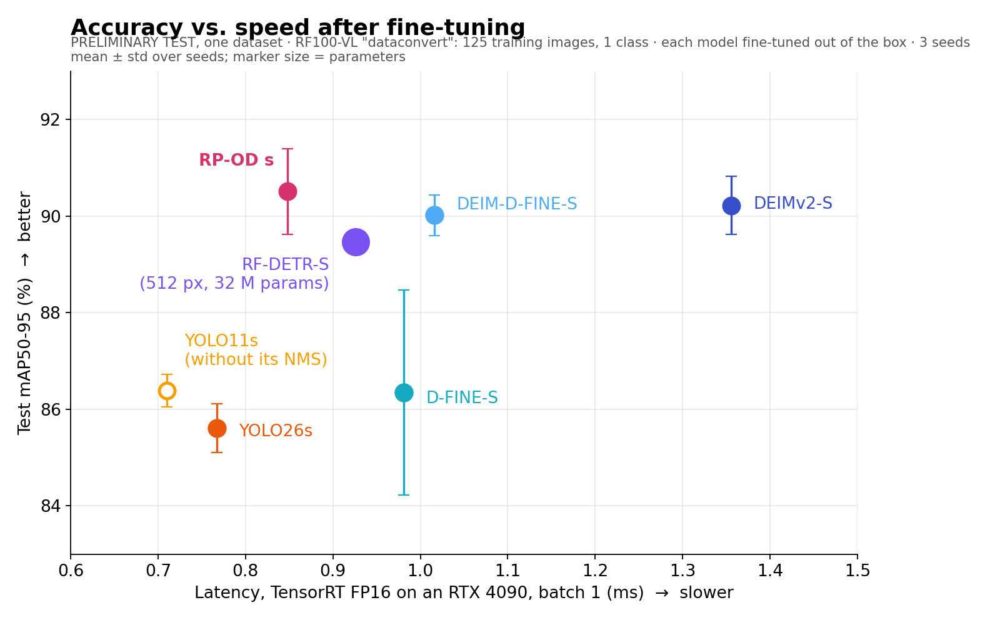
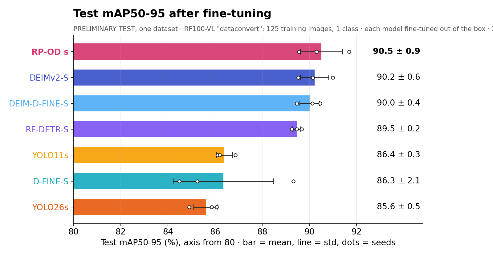
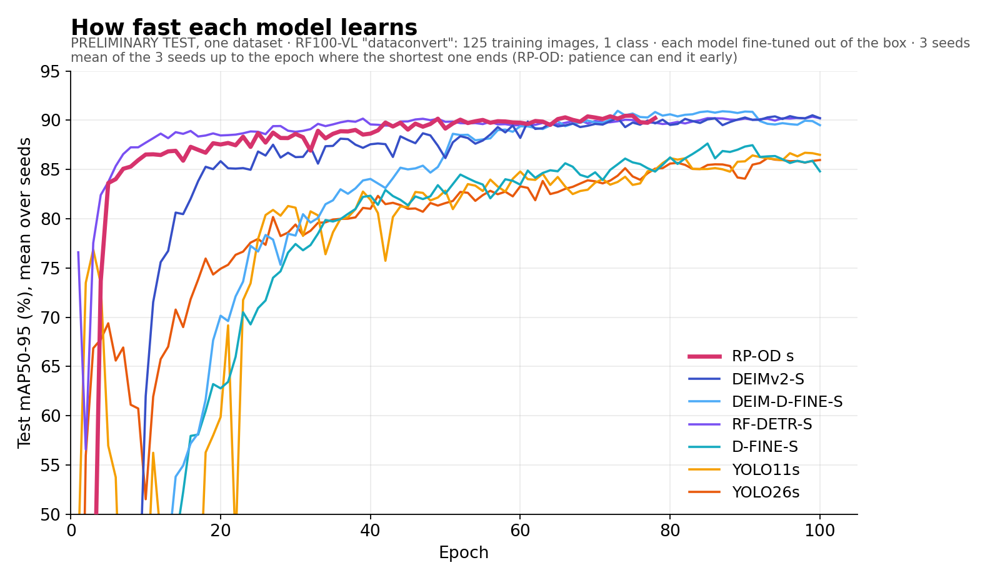

# RP-OD

Real-time object detection for industrial vision. A dense head proposes candidates and a transformer decoder refines
their boxes and removes duplicates, so there is no NMS. Overview of this family of detectors, with tensor shapes:
`docs/architecture.svg` (RP-OD uses the edge-distribution box head, option B). Each box edge is a
probability distribution that every decoder layer sharpens, and the last layer teaches the earlier ones
(`rpod/nn/decoder.py`, `rpod/loss/criterion.py`). Where each idea comes from: `docs/ORIGINS.md`.

Everything is used from Python through one object, `RPOD`.

## Fine-tuning comparison (preliminary test)

> **Preliminary test.** These numbers come from a single small dataset and are only a first check of the comparison
> protocol. A full study over many datasets will follow, and its results may differ from the ones below.

RP-OD is built to be fine-tuned on small custom datasets. This first test uses one dataset of the RF100-VL benchmark
(`dataconvert`: 125 training images, 35 validation, 19 test, 1 class): each model fine-tuned out of the box from its
COCO weights, 3 seeds each.





| Model | Test mAP50-95 | Test mAP50 | Test F1 | FP / image | Input | Parameters |
|---|---|---|---|---|---|---|
| **RP-OD `s`** | **90.5 ± 0.9** | 97.7 | 93.9 | 0.6 | 640 | 9.7 M |
| DEIMv2-S | 90.2 ± 0.6 | 97.1 | 93.2 | 0.6 | 640 | 9.7 M |
| DEIM-D-FINE-S | 90.0 ± 0.4 | 98.0 | 93.9 | 0.3 | 640 | 10.2 M |
| RF-DETR-S | 89.5 ± 0.2 | 98.1 | 93.9 | 0.5 | 512 | 31.8 M |
| YOLO11s | 86.4 ± 0.3 | 96.0 | 93.6 | 0.5 | 640 | 9.4 M |
| D-FINE-S | 86.3 ± 2.1 | 94.4 | 88.6 | 0.5 | 640 | 10.2 M |
| YOLO26s | 85.6 ± 0.5 | 95.6 | 92.3 | 0.6 | 640 | 9.9 M |

Inference time, TensorRT, batch 1, FP16 / FP32 (GPU time per image, median, without host-device copies):

| Model | Input | RTX 4090 | RTX 3060 | RTX 2060 |
|---|---|---|---|---|
| **RP-OD `s`** | 640 × 640 | 0.85 / 1.53 ms | 2.60 / 5.44 ms | 3.97 / 8.54 ms |
| D-FINE-S | 640 × 640 | 0.98 / 1.67 ms | 2.80 / 6.20 ms | 3.59 / 9.77 ms |
| DEIM-D-FINE-S | 640 × 640 | 1.02 / 1.71 ms | 2.84 / 6.24 ms | 3.69 / 9.77 ms |
| RF-DETR-S | 512 × 512 | 0.93 / 2.20 ms | 3.23 / 9.85 ms | 4.94 / 19.19 ms |
| DEIMv2-S | 640 × 640 | 1.36 / 3.14 ms | 4.08 / 13.78 ms | 5.45 / 23.46 ms |
| YOLO26s | 640 × 640 | 0.77 / 1.47 ms | 1.80 / 4.39 ms | 2.35 / 6.75 ms |
| YOLO11s | 640 × 640 | 0.71 / 1.39 ms + NMS | 1.73 / 4.28 ms + NMS | 2.27 / 6.59 ms + NMS |
| **RP-OD `s`** | 640 × 1568 | 1.25 / 2.41 ms | 4.85 / 11.38 ms | 6.86 / 18.77 ms |
| YOLO26s | 640 × 1568 | 1.10 / 2.20 ms | 4.05 / 10.14 ms | 5.34 / 16.89 ms |

640 × 1568 is the input of a wide industrial camera (2452 × 1000 images) at the same object scale as 640 × 640.

How it was measured:

- **Training**, each model with its own recipe and augmentations: RP-OD with the library defaults; YOLO with the
  Ultralytics defaults (100 epochs, batch 16, the RF100-VL protocol); D-FINE, DEIM and DEIMv2 with their official
  configs (augmentations, multi-scale, mixup where they use it) over 100 epochs at batch 16; RF-DETR with its defaults
  (100 epochs, batch 4 × 4, 512 px).
- **Evaluation**, the same for all: after every epoch the weights each framework validates predict the validation and
  test images, scored with pycocotools-equivalent mAP; each run counts with its epoch of best validation mAP50-95, and
  F1 uses the confidence threshold with the best F1 on validation.
- **Inference time**: each model's deployment ONNX, a TensorRT engine built on the GPU itself, batch 1; RTX 4090 with
  TensorRT 10.15 (median of 500 runs), RTX 3060 and RTX 2060 with TensorRT 10.9 and `trtexec` (median of 1000 runs).
  All the models are NMS-free except YOLO11s, whose NMS comes on top of the time shown. The accuracy-vs-speed chart
  uses the RTX 4090 FP16 column.
- One small dataset is not a verdict: the full study, the same comparison over many RF100-VL datasets, comes next.



## Install

Python 3.10 or newer, PyTorch 2.1 or newer.

```bash
pip install git+https://github.com/rosepetal-ai/rosepetal-research-RP-OD    # the library
pip install "rpod[export] @ git+https://github.com/rosepetal-ai/rosepetal-research-RP-OD"   # + ONNX export

git clone https://github.com/rosepetal-ai/rosepetal-research-RP-OD && cd rosepetal-research-RP-OD
pip install -e ".[dev]"     # development: tests, ONNX checks and the pycocotools comparison
```

## Create a model

Three sizes and nothing else to choose: classes come from the dataset and the input size is chosen when training.

```python
from rpod import RPOD

model = RPOD('s')                                # 's', 'm' (default) or 'l'
model.info(imgsz=640)                            # parameters per block and GFLOPs
```

| Size | Backbone | Neck | Decoder | Parameters | GFLOPs (640) |
|---|---|---|---|---|---|
| `s` | HGNetv2-B0 | 1 fusion block | 3 layers | 9.8 M | 26 |
| `m` | HGNetv2-B2 | 2 fusion blocks | 4 layers | 16.0 M | 45 |
| `l` | HGNetv2-B4 | 3 fusion blocks, twice as wide | 6 layers | 33.1 M | 110 |

Parameters with 80 classes (about 0.1 M less with a few). The backbone grows with the size; the neck and the decoder
are 256 channels wide in all three.

## Train

```python
model = RPOD('m')
res = model.train('parts.yaml', imgsz=640, epochs=150, patience=20, batch=4)
res['val'].map50_95, res['val'].recall, res['val'].threshold      # final metrics of the best epoch
model.predict(image)                                                # the object is now the best model
```

A new model starts from the COCO-pretrained weights of its size: release files of this repository, downloaded the
first time and cached in `~/.cache/rpod` (`RPOD_CACHE` moves it). Everything loads except the class heads, which
depend on the dataset. `pretrained=False` keeps only the ImageNet backbone. The weights are under the same license
as the code (below).

| Size | Release | COCO val2017 AP (AP50) |
|---|---|---|
| `s` | `rpod-s-coco-v1` | 45.1 (62.5) |
| `m` | `rpod-m-coco-v1` | 49.4 (67.1) |
| `l` | in training: until it is published, training prints that only the backbone is pretrained | |

Only data, input size, epochs, patience, batch, device and the augmentation function are chosen; the recipe is
fixed (adjusted with experiments on a real dataset):

| | |
|---|---|
| Optimizer | AdamW, lr 1e-4 for the whole network including the backbone, weight decay 1e-4 (none on norms, biases, embeddings) |
| Schedule | warmup, flat, cosine decay over the last 20 % of the epochs; `patience` epochs without improvement start that decay early, from the weights of the best epoch |
| Stability | EMA of the weights (what is validated and saved), gradient clipping 0.1, mixed precision on GPU, no dropout |
| Losses | classification: matchability-aware (MAL); boxes: L1 + GIoU, and on the edge distributions FGL + self-distillation from the last layer (DDF), on the union of the matches of all layers; on every decoder layer, the denoising queries and the dense head (every position, not only the selected ones) |
| Batch | `batch` is the effective batch, 4 by default: if it does not fit in the GPU it is split into accumulation steps, shown in the log; backbone BatchNorm is frozen below 8 images per step |
| Best epoch | highest 0.5 · mAP50-95 + 0.5 · recall (IoU ≥ 0.5, at the best-F1 threshold) |

Why these values: on a real dataset (77 training images), a backbone learning rate of 1e-4 instead of the usual
1e-5 gave +0.12 mAP50-95 on validation, and batch 4 instead of 8 another +0.06 (confirmed with three seeds).
Removing the flat phase, gradient clipping 10, weight decay 1e-3 and 300 epochs did not help. Going back to the
best epoch's weights for the final decay and for the clean last epochs did not hurt there (test mAP50-95 96.3 → 96.6,
three seeds each, within the noise) and on COCO added 0.4 AP to the best epoch of size `m`.

Training images are augmented by default with the recipe of the COCO pretraining (`rpod.data.augment`), before the
letterbox. Its phases are fractions of the training, so they scale with `epochs`, and they follow the real end when
`patience` brings it forward:

| Epochs | Augmentation (probability) |
|---|---|
| first 25 % | mosaic of 4 training images (0.5) |
| all but the last 4 % | brightness / contrast / saturation / hue (0.5), zoom-out up to 4x (0.5, not after a mosaic), crop that keeps objects (0.8), horizontal flip (0.5) |
| last 4 % (at least one) | none: training ends on clean images, starting again from the weights of the best epoch (which can still be any epoch, these included) |

```python
model.train('parts.yaml', augment=None)          # no augmentation
model.train('parts.yaml', augment=my_augment)    # your own function (contract under Datasets)

import rpod.data.augment as A
A.P_FLIP = 0.0                                   # change one value of the default recipe, e.g. no flips
```

Optional multi-scale training, off by default:

```python
model.train('parts.yaml', imgsz=640, multiscale=True)    # every batch at a random size, height and width apart
```

| Epochs | Height and width of each batch, drawn separately (at imgsz 640) |
|---|---|
| first 25 % | 0.5x – 1.5x imgsz (320 – 960): wide range, aspect ratios up to 3:1 |
| up to 5/6 | 0.75x – 1.25x imgsz (480 – 800) |
| last sixth | imgsz |

Each image is letterboxed from the original at the batch's size; validation stays at `imgsz`. A batch that does not
fit in the GPU at its size is split into accumulation steps, so the large sizes cost memory only when they come up.

The input needs at least as many candidate positions as the decoder keeps (300): 128×128 or larger.

`runs/train/<name>/` (the name gets a number if it exists):

```
weights/best.pt   weights/last.pt   results.csv (one row per epoch, written as it goes)   args.yaml
val/   test/      metrics.json, pr_curves.png, confusion_matrix.png, predictions.jpg (up to 16 images)
```

`best.pt` stores the recommended threshold (best mean F1 on val), used by default by `predict`, `val` and `export`.
Checkpoints from RP-OD up to `ba7e126`, before the box head became edge distributions, need that version.
The test split, if there is one, is evaluated once at the end with that threshold and never used for a decision.

## Validate

```python
model = RPOD('runs/train/exp/weights/best.pt')
m = model.val()                                   # val split of the training dataset -> runs/val/exp
m = model.val(data='other.yaml', split='test')    # another dataset: same class names, any order
m.map50_95, m.map50, m.precision, m.recall, m.f1, m.threshold, m.mean_iou, m.fp_per_image, m.fitness
m.per_class, m.confusion_matrix                   # confusion rows: true class + background, columns: predicted + background
```

mAP follows the COCO definition (checked against pycocotools); precision, recall, F1, mean IoU of the hits and false
positives per image are at the threshold with IoU ≥ 0.5. `m.map_small`, `m.map_medium`, `m.map_large`: mAP50-95 by
object size (small < 32×32, medium < 96×96), measured in pixels at the model input, with the COCO rules (also in
`results.csv` and in the training log).

## Predict and export (trained model)

```python
model = RPOD('runs/train/exp/weights/best.pt')
results = model.predict(image, color='BGR')     # numpy uint8 array + color tag, a file, a folder or a list
r = results[0]
r.boxes.xyxy, r.boxes.xyxyn, r.boxes.conf, r.boxes.cls, r.names
r.save('out.jpg')

model.export()                                   # model.onnx + config.json, for TensorRT, ONNX Runtime, Triton...
```

`predict` letterboxes the image (aspect ratio kept, gray padding), which is the input the exported model expects too,
and uses by default the confidence threshold recommended during validation. `export` fuses the neck for inference and
checks the ONNX against PyTorch. The ONNX takes one letterboxed image (0-1 values) and returns the boxes and class
logits of every query, with no NMS to add; `config.json` holds the classes, input size and recommended threshold
(contract in `rpod/engine/exporter.py`).

## Status

| Part | State |
|---|---|
| Model, configuration, `info`, `predict`, `export` | done |
| Data: YOLO format, dataset check with cache, default augmentation (replaceable) | done |
| Training, validation metrics and plots | done |
| COCO-pretrained weights | `s`, `m` published; `l` in training |

## Datasets

YOLO format: a `data.yaml` with `train` and `val` (required), `test` (optional, only ever used for a final
evaluation), and `names`. Every image and label is checked once (cached until a file changes): unreadable
images, images that are not 8-bit, segmentation polygons, classes out of range and boxes outside the image are
errors, listed with file and reason; identical images across splits and a missing `test` are warnings.

```python
from rpod.data import check_dataset
ds = check_dataset('parts.yaml')      # raises with the full list of errors; returns stats and warnings
```

The default augmentation can be replaced by any function, for example one built on an augmentation library, applied
to training samples before the letterbox (see `rpod/data/dataset.py` for the full contract):

```python
def augment(sample, ctx):
    # sample.image uint8 RGB, sample.boxes xyxy pixels, sample.labels, sample.path
    # ctx.sample(k), ctx.epoch, ctx.epochs (where training ends), ctx.imgsz, ctx.rng
    return sample
```

## COCO benchmark and pretraining

`benchmarks/coco/` trains and evaluates RP-OD on COCO 2017 with the protocol of the papers (AP with pycocotools,
640×640), with the default augmentation. The model it trains for each size is also the pretrained starting point
for training that size on other datasets.

## Tests

```bash
python3 -m pytest tests -q
```

## License

RP-OD is available under a dual licensing model:

- **Open Source License:** [GNU AGPLv3](LICENSE).
- **Commercial License:** the Rosepetal Enterprise License, available upon request for organizations requiring
  alternative licensing terms.

For commercial licensing inquiries, please contact licensing@rosepetal.ai.

Copyright (C) 2026 Rosepetal AI. The ideas RP-OD builds on, and their papers, are listed in `docs/ORIGINS.md`.
