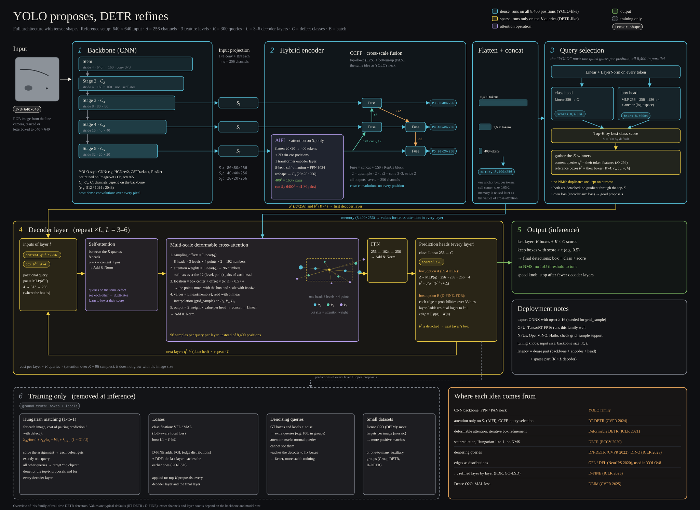
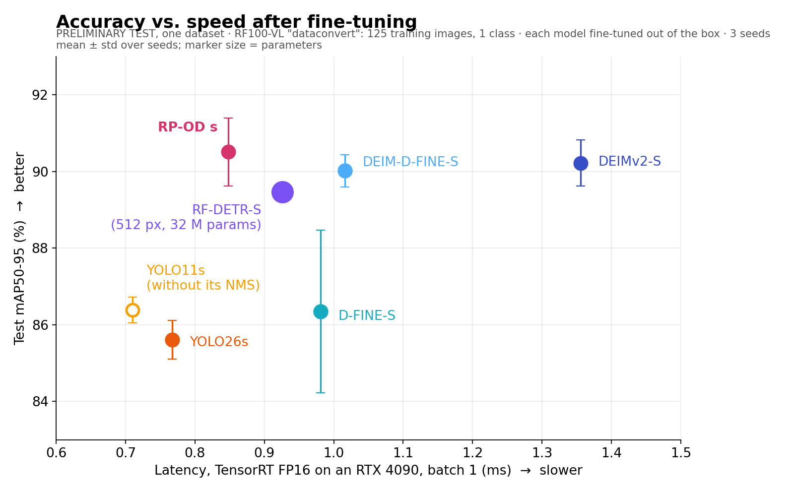
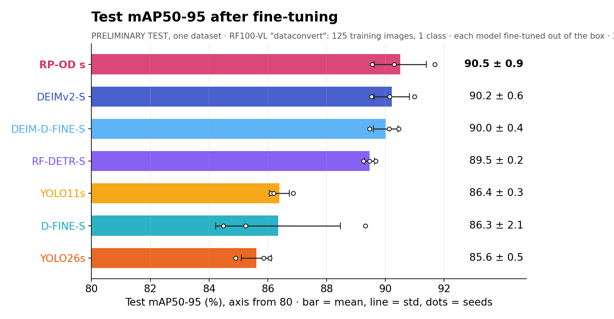
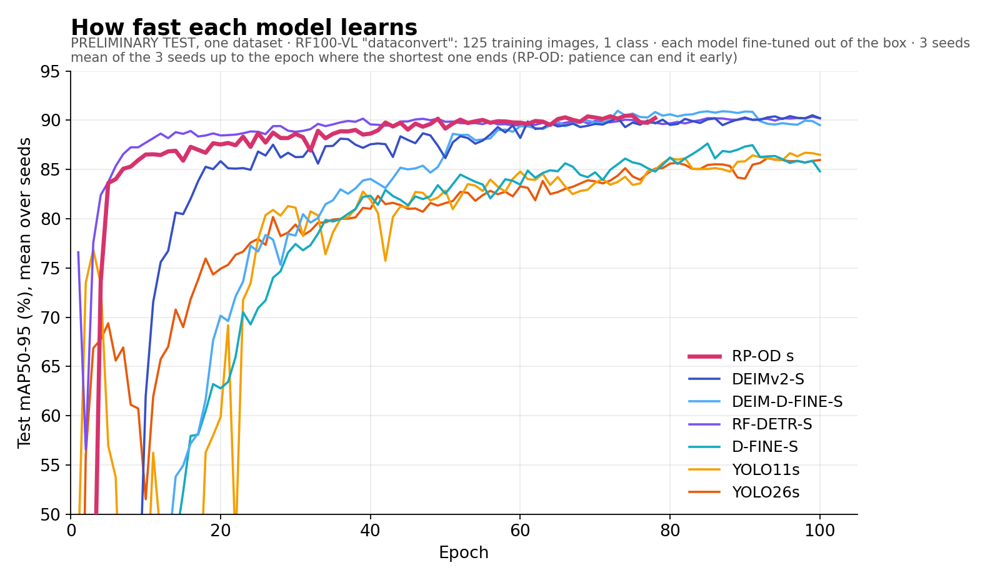

# RP-OD - Real-Time Object Detection without NMS

RP-OD (the Python package `rpod`) is a real-time object detector for industrial vision: a dense head proposes candidates and a transformer decoder refines their boxes and removes duplicates, so there is no NMS step; one object, `RPOD`, trains, validates, predicts and exports.

```python
from rpod import RPOD

model = RPOD('s')                                  # a new model: 's', 'm' (default) or 'l'
res = model.train('parts.yaml', imgsz=640)         # YOLO dataset; the object becomes the best model
results = model.predict('images/')                 # boxes in pixels of the original images
model.export()                                     # model.onnx + config.json
```

## Installation

The package is installed from the GitHub repository:

```bash
pip install git+https://github.com/rosepetal-ai/rosepetal-research-RP-OD    # the library
pip install "rpod[export] @ git+https://github.com/rosepetal-ai/rosepetal-research-RP-OD"   # + ONNX export

git clone https://github.com/rosepetal-ai/rosepetal-research-RP-OD && cd rosepetal-research-RP-OD
pip install -e ".[dev]"     # development: tests, ONNX checks and the pycocotools comparison
```

## Requirements

- Python 3.10 or newer.
- PyTorch 2.1 or newer, torchvision 0.16 or newer, timm 1.0.20 or newer, NumPy, SciPy, PyYAML, Pillow and Matplotlib, installed with the package (`pyproject.toml`).
- For `export()`: `onnx` and `onnxruntime` (the `export` extra).
- A CUDA GPU is used when PyTorch sees one, otherwise the CPU. On a GPU, training runs in mixed precision: bfloat16 where the card supports it natively, float16 otherwise.
- Internet access the first time a model of a size is trained: its COCO-pretrained weights are downloaded from the releases of the repository.

## Documentation

| Page | Content |
|---|---|
| [RP-OD](./index.md) | This page: the model, datasets, training, validation, prediction, export and the reported results |
| [Where RP-OD comes from](./ORIGINS.md) | Which part of RP-OD comes from which published detector (DETR, Deformable DETR, RT-DETR, D-FINE, DEIM, YOLO) and what RP-OD does differently |

## Architecture



The diagram shows the whole family of detectors, with tensor shapes at a 640 × 640 input and two possible box heads; RP-OD uses the edge-distribution head (option B).

- **Backbone**: an HGNetv2 network from timm with its ImageNet weights. The ImageNet normalization runs inside the model, so the input is the image divided by 255.
- **Neck**: the backbone maps at strides 8, 16 and 32 projected to 256 channels, one transformer encoder layer on the coarsest level, then top-down and bottom-up fusion with RepVGG blocks.
- **Query selection**: a dense head scores every position of the three levels (8,400 positions at 640 × 640) and the best K become the decoder's queries. K is 300, or five times the most objects in one training image when that is more.
- **Decoder**: each layer has self-attention between the queries (this is how duplicates learn to lower their score) and deformable cross-attention that samples 4 points per level around each query's box. Each box edge is a probability distribution over 33 positions that every layer refines, and in training the last layer teaches the earlier ones.
- **Output**: class logits and a box for every query. `predict` keeps the 100 best (query, class) scores above the confidence threshold; there is no IoU threshold to tune.

Which part comes from which paper, and what RP-OD changes: [Where RP-OD comes from](./ORIGINS.md).

## Model Sizes

Three sizes and nothing else to choose: the classes come from the dataset and the input size is chosen when training.

| Size | Backbone | Neck | Decoder | Parameters | GFLOPs (640) |
|---|---|---|---|---|---|
| `s` | HGNetv2-B0 | 1 fusion block | 3 layers | 9.8 M | 26 |
| `m` | HGNetv2-B2 | 2 fusion blocks | 4 layers | 16.0 M | 45 |
| `l` | HGNetv2-B4 | 3 fusion blocks, twice as wide | 6 layers | 33.1 M | 110 |

Parameters with 80 classes. The neck and the decoder are 256 channels wide in all three sizes. `model.info(imgsz=640)` prints the parameters per block and the GFLOPs at any input size.

```python
model = RPOD('m')                                  # new model of a size
model = RPOD('runs/train/exp/weights/best.pt')     # trained model: classes, input size and threshold come from it
model.info(imgsz=640)
```

## Datasets

RP-OD reads datasets in the YOLO format: a `data.yaml` file and one label file per image.

```yaml
path: /data/parts             # optional: the folder of the yaml by default
train: images/train           # required: a folder, a .txt listing images, or a list of those
val: images/val               # required
test: images/test             # optional, only ever used for a final evaluation
names: {0: scratch, 1: screw} # or a list
```

- Labels live in the parallel `labels` folder (`images/train/a.jpg` → `labels/train/a.txt`), one line per object: `class cx cy w h`, normalized 0-1. A missing or empty label file is an image without objects.
- Images: `.jpg`, `.jpeg`, `.png`, `.bmp`, `.tif`, `.tiff`, `.webp`, 8-bit.

Every image and label is checked once before training, and the result is cached (in `~/.cache/rpod/datasets`) until a file changes:

- **Errors** stop training and are listed with file, line and reason: missing or unreadable images, images that are not 8-bit, segmentation polygons, lines without 5 values, classes out of range, boxes with no width or height, boxes outside the image, and a `data.yaml` without `train`, `val` or valid `names` (ids 0 to N-1, without gaps or repeated names).
- **Warnings** are printed and training goes on: no `test` split (validation metrics are then optimistic, because validation picks the best epoch and the threshold), identical images in two splits or inside one, and boxes that lie on the edge of the image with no size once clipped, which are dropped.

```python
from rpod.data import check_dataset
ds = check_dataset('parts.yaml')      # raises with the full list of errors; returns the records, stats and warnings
```

## Training

```python
model = RPOD('m')
res = model.train('parts.yaml', imgsz=640, epochs=150, patience=20, batch=4)
res['val'].map50_95, res['val'].recall, res['val'].threshold      # final metrics of the best epoch
res['test']                                                         # the same on the test split, or None
model.predict(image)                                                # the object is now the best model
```

A new model starts from the COCO-pretrained weights of its size (see [Pretrained Weights](#pretrained-weights)): everything loads except the class heads, which depend on the dataset. `pretrained=False` keeps only the ImageNet backbone; a model loaded from a checkpoint starts from that checkpoint.

| Argument | Default | Meaning |
|---|---|---|
| `data` | (required) | Path of the `data.yaml` |
| `imgsz` | `640` | An int or `[height, width]`, each rounded up to a multiple of 32. The image is letterboxed into it, here and in production |
| `epochs` | `150` | Epochs to train. With `time`, the most it may train |
| `patience` | `20` | Epochs without improvement before the final decay starts early (from the best epoch's weights); `None` never; or a function of the planned epochs |
| `batch` | `4` | Effective batch. If it does not fit in the GPU it is split into accumulation steps, shown in the log |
| `device` | `cuda` if available, else `cpu` | Device to train on |
| `augment` | the default recipe | `None` for no augmentation, an `Augment(...)` with other values, or your own function |
| `oversample` | `None` | Repeat images with rare classes in every epoch (a threshold between 0 and 1) |
| `multiscale` | `False` | Train every batch at a random size (see below) |
| `pretrained` | `True` | Start a new model from the COCO weights of its size |
| `time` | `None` | Seconds for the whole call: train to a time budget instead of a number of epochs |
| `reserve` | `None` | Seconds of `time` kept for the caller after training, or a function of the measured stats |
| `final_eval` | `True` | `False` skips the final evaluation of the best weights on val and test (`val` and `test` come back `None`) |
| `name`, `project` | `'exp'`, `'runs/train'` | The run goes to `project/name`, with a number added if the folder exists |
| `workers` | `None` | Dataloader workers: the `RPOD_WORKERS` environment variable, else the number of CPUs up to 8 |

`train` returns a dict with `dir` (the run folder), `best_epoch`, `val` and `test` (metrics), `planned_epochs`, `stop_reason` (`'EPOCHS_COMPLETED'`, `'EARLY_STOPPED'` or `'TIME_BUDGET_REACHED'`) and `budget_overrun_s` (with `time`: seconds past the budget, negative when time was left).

### Training Recipe

Everything else is fixed:

| Part | Choice |
|---|---|
| Optimizer | AdamW, learning rate 1e-4 for the whole network including the backbone, weight decay 1e-4 (none on norms, biases and embeddings) |
| Schedule | Warmup (2,000 steps, or 5 % of the steps when that is fewer), flat, then a cosine decay to 5 % of the learning rate over the last 20 % of the epochs. `patience` epochs without improvement start that decay early, from the weights of the best epoch |
| Stability | EMA of the weights (what is validated and saved), gradient clipping at 0.1, mixed precision on GPU, no dropout |
| Losses | Classification: matchability-aware loss (MAL). Boxes: L1 + GIoU, and on the edge distributions FGL + self-distillation from the last layer (DDF), on the union of the matches of all layers. Applied on every decoder layer, the denoising queries and the dense head (every position, not only the selected ones) |
| Batch | Backbone BatchNorm is frozen when fewer than 8 images fit in one step |
| Best epoch | Highest validation mAP50-95; on a tie, the later epoch |
| Last epochs | The last 4 % of the epochs (at least one; the `clean_fraction` of an `Augment`) start again from the weights of the best epoch, and the default augmentation leaves their images as they are |

Why these values: on a real dataset (77 training images), a backbone learning rate of 1e-4 instead of the usual 1e-5 gave +0.12 mAP50-95 on validation, and batch 4 instead of 8 another +0.06 (three seeds). Going back to the best epoch's weights for the final decay and the clean last epochs did not hurt there (test mAP50-95 96.3 → 96.6, three seeds each, within the noise), and on COCO one clean epoch from the best epoch added 0.4 AP to size `m` and 0.3 to size `l`.

### Augmentation

Training images are augmented by default with the recipe of the COCO pretraining (`rpod.data.augment`), before the letterbox. Its phases are fractions of the training, so they scale with `epochs`, and they follow the real end of training when `patience` brings it forward:

| Epochs | Augmentation (probability) |
|---|---|
| First 25 % | Mosaic of 4 training images (0.5) |
| All but the last 4 % | Brightness, contrast, saturation and hue (0.5); zoom-out up to 4 times the image side (0.5, not after a mosaic); a crop that keeps objects (0.8); horizontal flip (0.5) |
| Last 4 % (at least one epoch) | None |

```python
model.train('parts.yaml', augment=None)          # no augmentation
model.train('parts.yaml', augment=my_augment)    # your own function

from rpod.data import Augment                    # the default recipe with other values
model.train('parts.yaml', augment=Augment(hflip=0.0, mosaic_fraction=0.4, clean_fraction=0.1))
```

`Augment` fields: the probabilities `mosaic`, `photometric`, `zoom_out`, `iou_crop` and `hflip`, `zoom_out_max`, and the phases `mosaic_fraction` and `clean_fraction`, which the trainer follows too (its clean last epochs and its time planning).

Your own function receives each training sample before the letterbox and returns it, at any size:

```python
def augment(sample, ctx):
    # sample.image uint8 RGB [H, W, 3]; sample.boxes xyxy in pixels; sample.labels; sample.path
    # ctx.sample(k): k more random training samples; ctx.epoch (from 0); ctx.epochs (where training ends);
    # ctx.imgsz; ctx.rng (numpy generator); ctx.mosaic / ctx.clean: the phase, with a time budget
    return sample
```

Boxes are clipped to the image afterwards and boxes under 1 pixel are dropped.

### Rare Classes

`oversample=0.3` repeats, in every epoch, the images that hold rare classes (LVIS repeat-factor sampling, off by default). A class present in a share `f` of the training images gets the factor `max(1, sqrt(0.3 / f))`, and each image appears the rounded highest factor of its classes times per epoch. On a 628-image dataset with four rare defects it took the epoch to 824 images and raised test mAP50-95 from 81.1 to 81.9 (three seeds; the rare classes from 57.1 to 59.8).

### Training to a Time Budget

```python
res = model.train('parts.yaml', time=30 * 60, epochs=500)   # 30 min for the whole call; at most 500 epochs
res['planned_epochs'], res['stop_reason']
```

The phases become shares of the time: mosaic in the first 25 %, the final decay in the last 20 %, clean images in the last 4 %. After every epoch RP-OD measures what each kind of epoch costs (with mosaic, without, clean; the mean of the last three of each) and plans the rest from the time left. A phase that has started does not move back: the decay can only get shorter and the mosaic does not return. Training stops between epochs, never inside one, and the last epoch is always a clean one from the best weights. `reserve=` keeps time for what the caller does afterwards; `patience=` can be a function of the planned epochs. A time budget does not work with `multiscale=True`.

### Multi-scale Training

```python
model.train('parts.yaml', imgsz=640, multiscale=True)    # every batch at a random size, height and width apart
```

| Epochs | Height and width of each batch, drawn separately (at `imgsz` 640) |
|---|---|
| First 25 % | 0.5 to 1.5 times `imgsz` (320 to 960) |
| Up to five sixths | 0.75 to 1.25 times `imgsz` (480 to 800) |
| Last sixth, and the clean last epochs | `imgsz` |

Each image is letterboxed from the original at the batch's size; validation stays at `imgsz`. A batch that does not fit in the GPU at its size is split into accumulation steps.

The input must have at least as many candidate positions as the decoder keeps queries: 128 × 128 or larger for the usual 300 queries.

### Run Folder

```
runs/train/exp/
  weights/best.pt    weights/last.pt
  results.csv        one row per epoch, written as it goes
  args.yaml          the arguments and the recipe of the run
  val/   test/       metrics.json, pr_curves.png, confusion_matrix.png, predictions.jpg (up to 16 images)
```

`best.pt` stores the recommended confidence threshold (the best mean F1 over classes on validation), used by default by `predict`, `val` and `export`. The test split, if there is one, is evaluated once at the end with that threshold and never used for a decision. Checkpoints made by RP-OD up to commit `ba7e126`, before the box head became edge distributions, need that version.

## Validation

```python
model = RPOD('runs/train/exp/weights/best.pt')
m = model.val()                                   # val split of the training dataset -> runs/val/exp
m = model.val(data='other.yaml', split='test')    # another dataset: same class names, in any order
m.map50_95, m.map50, m.precision, m.recall, m.f1, m.threshold, m.mean_iou, m.fp_per_image, m.fitness
m.map_small, m.map_medium, m.map_large            # mAP50-95 by object size, -1 when there is none of a size
m.per_class, m.confusion_matrix
```

- mAP50-95 and mAP50 follow the COCO definition (the tests compare them with pycocotools).
- Precision, recall, F1, the mean IoU of the hits and the false positives per image are measured at the threshold, with IoU ≥ 0.5; precision, recall and F1 are means over the classes present.
- Object sizes are measured in pixels at the model input: small under 32 × 32, medium under 96 × 96.
- Confusion matrix rows are the true class plus background, columns the predicted class plus background.

## Prediction

```python
model = RPOD('runs/train/exp/weights/best.pt')
results = model.predict(image, color='BGR')     # a numpy uint8 array with its color tag, a file, a folder or a list
r = results[0]
r.boxes.xyxy, r.boxes.xyxyn, r.boxes.conf, r.boxes.cls, r.names
r.save('out.jpg')                               # the image with the detections drawn
```

- `color` is `'RGB'` (default), `'BGR'` or `'GRAY'` for arrays; files are read as RGB. Only 8-bit images are accepted.
- `conf` defaults to the threshold stored in the checkpoint; `max_det=100`.
- `predict` letterboxes the image (aspect ratio kept, gray padding), which is the input the exported model expects too, and returns boxes in pixels of the original image.

## Export

```python
model.export()                  # runs/train/exp/weights/best_export/: model.onnx + config.json
model.export('deploy/parts')    # another folder
```

`export` fuses the BatchNorms and RepVGG branches of the neck and writes, by default, to a folder named after the checkpoint (`best_export` next to `best.pt`). The ONNX model (opset 17) has a fixed input size:

| Role | Name | Shape | Content |
|---|---|---|---|
| Input | `images` | float32 `[1, 3, H, W]` | One letterboxed RGB image, values 0-1 |
| Output | `dets` | float32 `[1, K, 4]` | Boxes of every query: cx, cy, w, h, normalized on the letterboxed input |
| Output | `labels` | float32 `[1, K, C]` | Class logits: apply a sigmoid and keep the scores above the threshold, with no NMS |

`config.json` holds the model name (`rpod-s`, `rpod-m` or `rpod-l`), the input shape, the classes and the confidence threshold recommended by validation. A TensorRT engine, or the model of any other runtime, is built from the ONNX on the machine that serves it.

## Pretrained Weights

A new model starts from the COCO-pretrained weights of its size: release files of this repository, downloaded the first time, checked against their SHA-256 and cached in `~/.cache/rpod` (the `RPOD_CACHE` environment variable moves it). The weights are under the same license as the code.

| Size | Release | COCO val2017 AP (AP50) |
|---|---|---|
| `s` | `rpod-s-coco-v1` | 45.1 (62.5) |
| `m` | `rpod-m-coco-v1` | 49.4 (67.1) |
| `l` | `rpod-l-coco-v1` | 52.3 (70.1) |

Each size was trained on COCO 2017 from its ImageNet backbone with the scripts of [`benchmarks/coco`](https://github.com/rosepetal-ai/rosepetal-research-RP-OD/tree/main/benchmarks/coco), which follow the protocol of the papers RP-OD compares with (AP with pycocotools on val2017, 640 × 640) and use the library's default augmentation.

## Fine-tuning Comparison (Preliminary Test)

> [!WARNING]
> **Preliminary test.** These numbers come from a single small dataset and are only a first check of the comparison protocol. A full study over many datasets will follow, and its results may differ from the ones below.

RP-OD is built to be fine-tuned on small custom datasets. This first test uses one dataset of the RF100-VL benchmark (`dataconvert`: 125 training images, 35 validation, 19 test, 1 class): each model fine-tuned out of the box from its COCO weights, 3 seeds each.





| Model | Test mAP50-95 | Test mAP50 | Test F1 | FP / image | Input | Parameters |
|---|---|---|---|---|---|---|
| **RP-OD `s`** | **90.5 ± 0.9** | 97.7 | 93.9 | 0.6 | 640 | 9.7 M |
| DEIMv2-S | 90.2 ± 0.6 | 97.1 | 93.2 | 0.6 | 640 | 9.7 M |
| DEIM-D-FINE-S | 90.0 ± 0.4 | 98.0 | 93.9 | 0.3 | 640 | 10.2 M |
| RF-DETR-S | 89.5 ± 0.2 | 98.1 | 93.9 | 0.5 | 512 | 31.8 M |
| YOLO11s | 86.4 ± 0.3 | 96.0 | 93.6 | 0.5 | 640 | 9.4 M |
| D-FINE-S | 86.3 ± 2.1 | 94.4 | 88.6 | 0.5 | 640 | 10.2 M |
| YOLO26s | 85.6 ± 0.5 | 95.6 | 92.3 | 0.6 | 640 | 9.9 M |

Inference time, TensorRT, batch 1, FP16 / FP32 (GPU time per image, median, without host-device copies):

| Model | Input | RTX 4090 | RTX 3060 | RTX 2060 |
|---|---|---|---|---|
| **RP-OD `s`** | 640 × 640 | 0.85 / 1.53 ms | 2.60 / 5.44 ms | 3.97 / 8.54 ms |
| D-FINE-S | 640 × 640 | 0.98 / 1.67 ms | 2.80 / 6.20 ms | 3.59 / 9.77 ms |
| DEIM-D-FINE-S | 640 × 640 | 1.02 / 1.71 ms | 2.84 / 6.24 ms | 3.69 / 9.77 ms |
| RF-DETR-S | 512 × 512 | 0.93 / 2.20 ms | 3.23 / 9.85 ms | 4.94 / 19.19 ms |
| DEIMv2-S | 640 × 640 | 1.36 / 3.14 ms | 4.08 / 13.78 ms | 5.45 / 23.46 ms |
| YOLO26s | 640 × 640 | 0.77 / 1.47 ms | 1.80 / 4.39 ms | 2.35 / 6.75 ms |
| YOLO11s | 640 × 640 | 0.71 / 1.39 ms + NMS | 1.73 / 4.28 ms + NMS | 2.27 / 6.59 ms + NMS |
| **RP-OD `s`** | 640 × 1568 | 1.25 / 2.41 ms | 4.85 / 11.38 ms | 6.86 / 18.77 ms |
| YOLO26s | 640 × 1568 | 1.10 / 2.20 ms | 4.05 / 10.14 ms | 5.34 / 16.89 ms |

640 × 1568 is the input of a wide industrial camera (2452 × 1000 images) at the same object scale as 640 × 640.

How it was measured:

- **Training**, each model with its own recipe and augmentations: RP-OD with the library defaults; YOLO with the Ultralytics defaults (100 epochs, batch 16, the RF100-VL protocol); D-FINE, DEIM and DEIMv2 with their official configs (augmentations, multi-scale, mixup where they use it) over 100 epochs at batch 16; RF-DETR with its defaults (100 epochs, batch 4 × 4, 512 px).
- **Evaluation**, the same for all: after every epoch the weights each framework validates predict the validation and test images, scored with pycocotools-equivalent mAP; each run counts with its epoch of best validation mAP50-95, and F1 uses the confidence threshold with the best F1 on validation.
- **Inference time**: each model's deployment ONNX, a TensorRT engine built on the GPU itself, batch 1; RTX 4090 with TensorRT 10.15 (median of 500 runs), RTX 3060 and RTX 2060 with TensorRT 10.9 and `trtexec` (median of 1000 runs). All the models are NMS-free except YOLO11s, whose NMS comes on top of the time shown. The accuracy-vs-speed chart uses the RTX 4090 FP16 column.



## Tests

```bash
python3 -m pytest tests -q
```

The tests never download the COCO weights; the comparison with pycocotools runs only when `pycocotools` is installed (the `dev` extra), and one training test needs a GPU.

## License

RP-OD is available under a dual licensing model:

- **Open source**: the GNU Affero General Public License, version 3 only ([LICENSE](https://github.com/rosepetal-ai/rosepetal-research-RP-OD/blob/main/LICENSE)).
- **Commercial**: the Rosepetal Enterprise License, under a separate written agreement with Rosepetal AI. Contact licensing@rosepetal.ai.

Copyright (C) 2026 Rosepetal AI.
